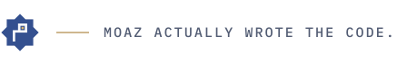

<p align="center">
  <picture>
    <source media="(prefers-color-scheme: dark)" srcset="assets/brand/moaz-code/banner-dark.svg">
    
  </picture>
</p>

<p align="center">
  <b>A coding agent that teaches you to code, instead of coding for you.</b>
</p>

---

## Overview

Coding agents can now write whole features from one sentence. That feels
productive, but if you're learning to code, you end up approving work you
couldn't write, explain or debug yourself. The AI learned. You didn't.

Moaz-Code is a CLI coding agent built for people who want to actually get
better. It works like a senior engineer tutoring you: it explains the _why_,
points out problems, asks for the test first and reviews your code honestly.
Then it leaves the keyboard to you.

The name plays on [moaz-coe.com](https://moaz-coe.com).

## Implementation

A small agent written from scratch in object-oriented Python:

```
-p "prompt" ─▶ Gate (slash commands → skills)
             ─▶ Agent loop ──▶ LLM (OpenRouter)
                    ▲              │ tool calls
                    └── ToolRegistry ◀┘  Read · Write · Bash
             ─▶ final answer on stdout (logs go to stderr)
```

| Path                    | Responsibility                                                  |
| ----------------------- | --------------------------------------------------------------- |
| `app/main.py`           | Composition root: builds the client, registry, skills and agent |
| `app/agent/`            | The agent loop (`core.py`) and subagents (`subagent.py`)        |
| `app/tools/base.py`     | `Tool` ABC: `name`, `description`, `properties`, `run()`        |
| `app/tools/registry.py` | `ToolRegistry`: name → tool, schema list, dispatch              |
| `app/skills/`           | Load, parse and render skills for the system prompt             |
| `app/input/gate.py`     | Turns `/skill` slash commands into prompts                      |
| `app/prompts/`          | System prompt construction                                      |

Tools return error _strings_ instead of raising, so the model sees the failure
and can recover. Skills are loaded from `.agents/skills/` and
`.claude/skills/`, where each skill is a `SKILL.md` file with YAML frontmatter.

## Running it

You need [`uv`](https://docs.astral.sh/uv/) and Python ≥ 3.14.

```sh
echo 'OPENROUTER_API_KEY=sk-or-...' > .env
./your_program.sh -p "explain what app/agent/core.py does"
```

Development:

```sh
uv run pytest          # tests
uv run ruff check .    # lint
uv run ruff format .   # format
```

### In a container (recommended)

The agent has a `Bash` tool, so the model can run any command. To keep that
off your machine, run it in the dev container. The project is mounted
**read-only**, and only `agent_workspace/` is writable.

```sh
./dev.sh                                  # open a shell in the container
mcode "create a file named hello.txt"     # run the agent (inside the container)
LOG_LEVEL=INFO mcode "create a file named hello.txt" # To run with logs on
```

- Edit code on your host. The container sees changes immediately.
- Run `git` and `ruff format` on the host, because the container can't write to the project.
- Your `.env` is passed in as environment variables. The network is open, so use an API key with a low spending limit.
- Rebuild after editing the Dockerfile: `docker compose -f docker/compose.yml build`.
- This is a safety net, not a hardened sandbox.

---

<p align="center">
  <picture>
    <source media="(prefers-color-scheme: dark)" srcset="assets/brand/moaz-code/signature-dark.svg">
    
  </picture>
</p>
